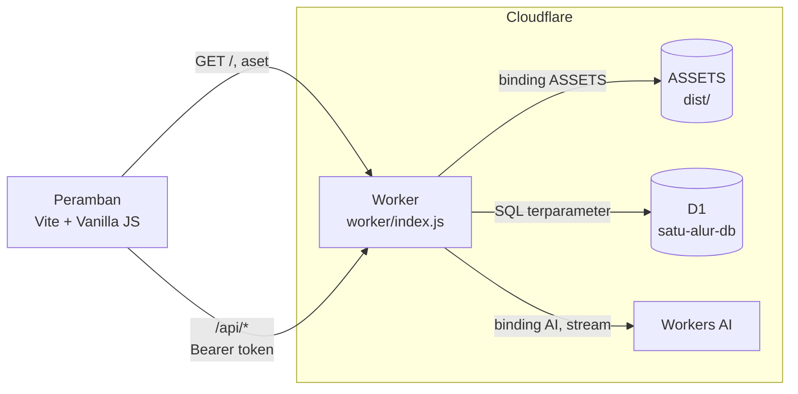
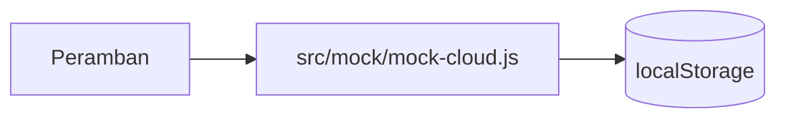
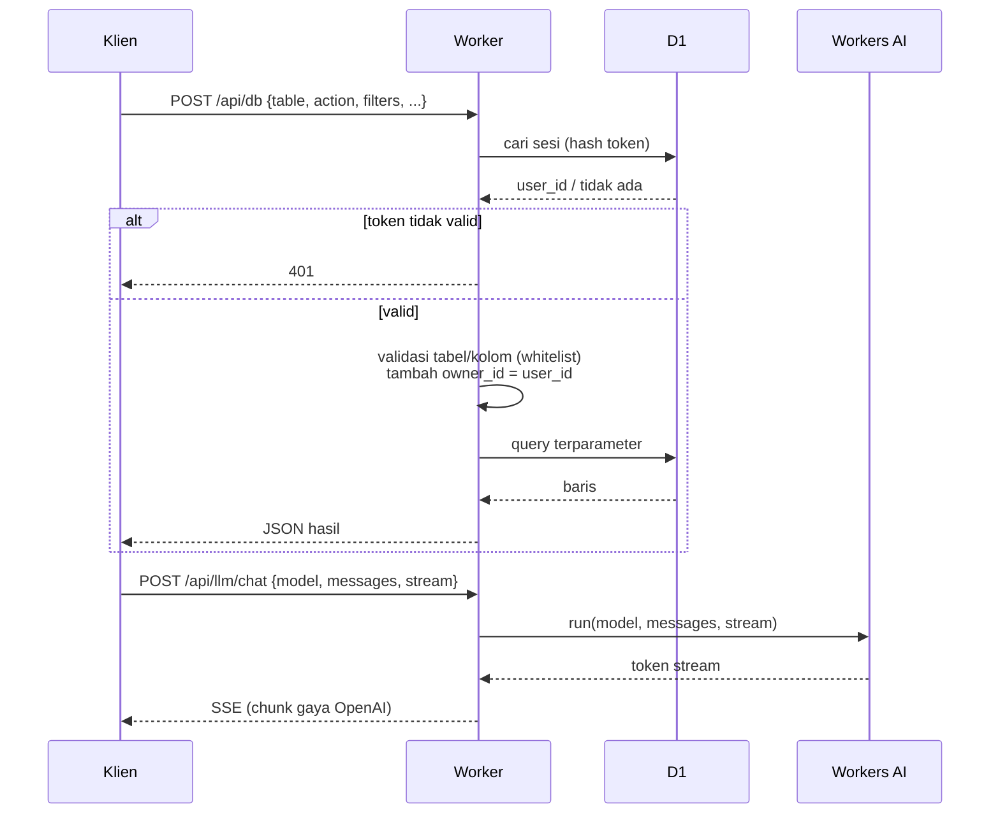
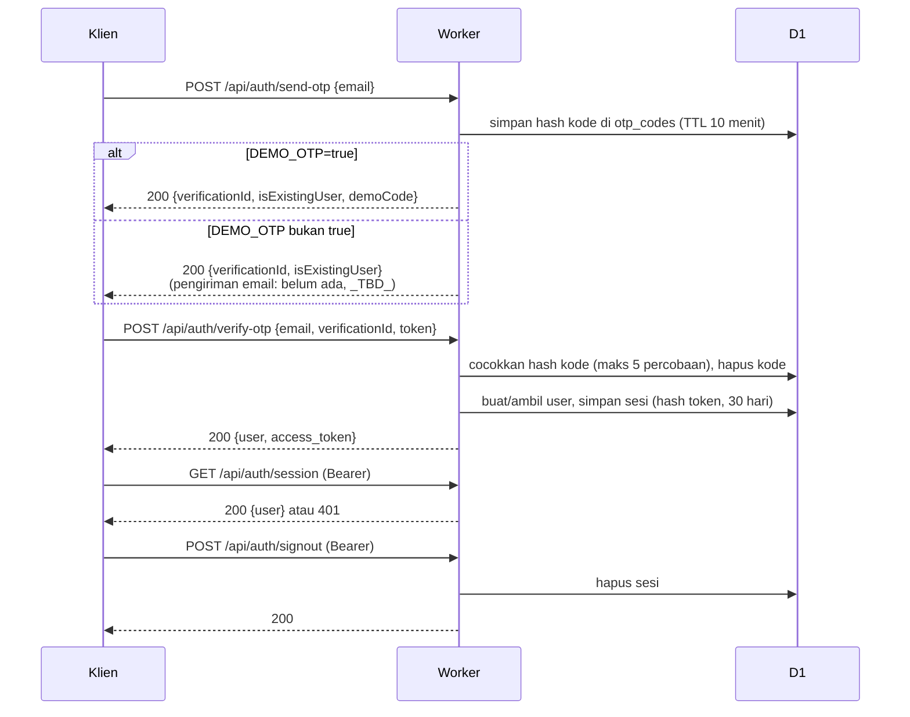
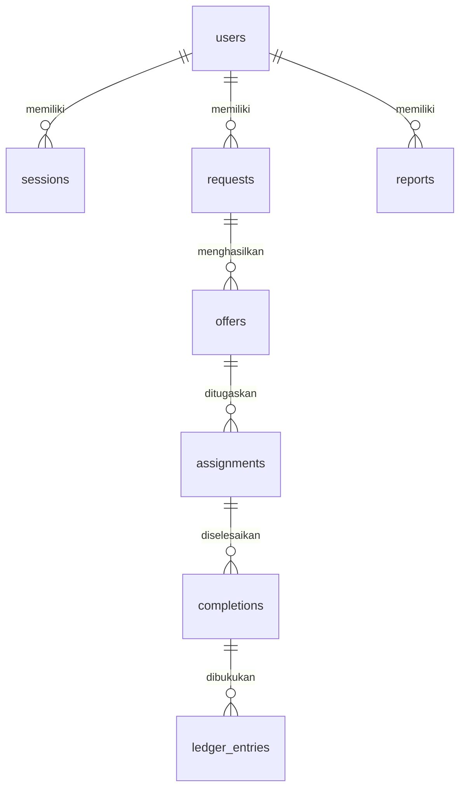

# Arsitektur

> Status: Draft
> Terakhir diperbarui: 2026-10-28
> Pemilik: _TBD_

Arsitektur setelah port ke Cloudflare. Keputusan dan alasannya di [11_DECISIONS.md](11_DECISIONS.md); detail rute di [21_BACKEND.md](21_BACKEND.md).

## 1. Gambaran Sistem

Satu Worker melayani dua hal: aset statis hasil build Vite dan API di `/api/*`. Data disimpan di D1, LLM lewat Workers AI.

Mode lokal tanpa backend (mock) melewati Worker sepenuhnya:

## 2. Alur Permintaan

Rute non-API dilayani dari `ASSETS`. Rute API diperiksa autentikasinya, lalu diteruskan ke handler.

## 3. Alur Autentikasi OTP

Bentuk respons tepat ada di [API.md](API.md). Provider email belum ada (ADR-004).

## 4. Lapisan Klien

| Lapisan | Berkas | Peran |
|---------|--------|-------|
| UI | `src/ui/` | Komponen, animasi, mesin AntiSlop |
| Stage | `src/stages/` | Enam tahap, dashboard, pengaturan |
| Domain | `src/domain/` | Status/enum, aturan validasi penawaran |
| AI | `src/ai/` | Prompt dan pemanggilan LLM (streaming) |
| Auth | `src/auth/` | OTP dan sesi |
| Akses data | `src/cloud.js` | Pemilih backend: Worker atau mock |
| Mock | `src/mock/` | Backend `localStorage` untuk pengembangan |

Stage memanggil `getCloud()`; implementasi (klien `/api/*` atau mock) dipilih oleh `VITE_USE_MOCK`. Klien `/api/*` ada di `src/http-cloud.js` (`createHttpCloud`: auth, database builder, llm); mock tetap di `src/mock/mock-cloud.js`.

## 5. Model Data

Enam entitas domain membentuk rantai berikut; semua baris membawa `owner_id`.

`otp_codes` berdiri sendiri (kunci berdasarkan email). Kolom dan tipe di [20_DATABASE.md](20_DATABASE.md).

## 6. Keamanan Ringkas

- Isolasi data dilakukan di Worker (tanpa RLS): setiap query `/api/db` diberi `owner_id`.
- Whitelist tabel dan kolom, nilai lewat bind parameter.
- Token sesi disimpan sebagai hash.
- Mode demo OTP hanya untuk uji.

Rincian dan risiko: [21_BACKEND.md](21_BACKEND.md), [10_RISK_REGISTER.md](10_RISK_REGISTER.md).

## 7. Deployment

`npm run deploy` membangun `dist/` dan mendeploy Worker beserta aset. Langkah lengkap di [18_INSTALLATION.md](18_INSTALLATION.md).
